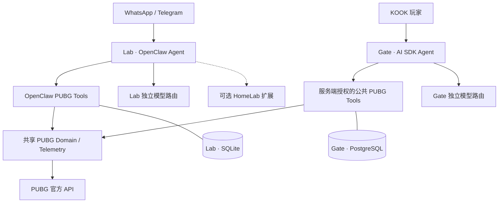

# Amadeus Home

**两条开源 Kurisu 世界线：Lab（OpenClaw 自托管）与 Gate（KOOK 小队服务）· 共享 PUBG Domain**

[](https://github.com/ChristmasFox/amadeus-home/actions/workflows/community-pubg-onboarding.yml)

> **🚧 社区预览版 / Community Preview**
>
> 已公开源码、PUBG 小队初始化和独立 Docker Compose 配置，并采用 [MIT License](LICENSE)。2026-10-12 已完成公开分支与 Tag 的敏感信息历史改写；GitHub 旧 PR 引用及缓存仍可能保留历史对象，相关清理已申请 Support 审查。**尚未完成全新 Linux 主机上的真实 WhatsApp/PUBG/9Router 端到端验收**，请勿将此预览版视为已验证的一键生产部署。
>
> **原生产环境维护者：** 本次更新把个人 9Router 生图账号白名单移出了 Git。更新本地仓库及下一次生产部署前，务必阅读 [私有账号策略迁移](docs/PRODUCTION_9ROUTER_POLICY_MIGRATION.md)，避免因缺少本地策略文件而导致部署拒绝。

## Lab / Gate：两条产品世界线

**Lab 与 Gate 都使用 Kurisu 的人格风格，也都可以开源。** 它们是两个独立部署的 Agent 产品，而不是两个不同角色；区别在架构、服务方式和运行数据，不在代码是否开放。

| 代称 | 运行方式 | 当前状态 |
| --- | --- | --- |
| **Lab** | OpenClaw + WhatsApp/Telegram + SQLite + 可选 HomeLab 扩展；**自托管 Kurisu**，任何社区用户都可自行部署 | 本 README 的社区 Docker 快速开始以 Lab 为基础 |
| **Gate** | Vercel AI SDK Agent + KOOK + 独立 Worker / PostgreSQL；**多租户小队服务 Kurisu** | **Gate-Local** 在 Mac mini 独立测试，M2 真人试用中 |
| **Gate-Prod** | Gate 将来的云端正式服务 | **尚未上线**；云服务器未选定 |

**Gate 指产品，不指主机。** Gate-Local 是本地测试环境，Gate-Staging 是未来预发布环境，Gate-Prod 是未来正式生产环境。迁云后 Gate 仍叫 Gate；正式迁移切换后，不能在本地和云端同时运行使用同一正式 KOOK Bot 身份的 Gateway/Worker。

两端只共享 PUBG 源码与适用的事实展示契约：[`packages/pubg-domain`](packages/pubg-domain/) 和 [`packages/presentation`](packages/presentation/)。**各实例的记忆、会话、用户数据、数据库、权限与凭据独立**；源码开源不意味着运行数据共享。

### 独立产品版本

Lab 使用根目录 [`VERSION`](VERSION) 与 [`RELEASE_NOTES.md`](RELEASE_NOTES.md)；Gate 使用 [`apps/pubg-saas/package.json`](apps/pubg-saas/package.json) 的 `version` 和 [Gate Release Notes](apps/pubg-saas/RELEASE_NOTES.md)。根 `package.json.version` 是 Monorepo 工具元数据，不是产品版本。两端按标准 SemVer 独立递进；正式 Tag 分别是 `lab/vX.Y.Z` 和 `gate/vX.Y.Z`。Candidate 由 Git SHA 与镜像 digest 标识，不代表正式发行。

发布命令与 Candidate/回滚操作边界见[双产品 Release Engineering 手册](docs/RELEASE_ENGINEERING.md)。

> **部署范围：** 下文“快速开始”适用于 **Lab 风格的社区 WhatsApp / OpenClaw 安装**，不是 Gate-Prod 的安装教程。Gate 当前仅处于本地 M2 验收。相关资料：[Gate 应用说明](apps/pubg-saas/README.md) · [Gate Compose](infra/pubg-saas/README.md) · [架构文档](docs/ARCHITECTURE.md)。

## 从 PUBG 战绩机器人开始

和朋友打 PUBG，最常遇到的问题就是：**谁踢了队友？伤害打了多少？这周谁最能打？**

Lab 可以让用户在 WhatsApp 私聊或群聊自然提问；Gate 则面向 KOOK 玩家小队，支持普通聊天与按需调用 PUBG 工具。两端都通过 PUBG 官方 API 与比赛 Telemetry 获取事实，再由各自的 Agent 组织回复。

**不必每次都重新下载整场比赛：Lab 使用 SQLite、Gate 使用 PostgreSQL 持久化事实，双方复用增量同步、统计与 Telemetry 领域语义。** 在配置好定时任务后，还能提前同步比赛和事件数据，让后续查询尽量减少现场下载。

> “查询昨天的小队战绩。”
>
> “这周谁的 KD 最高？谁对队友造成的伤害最多？”
>
> “总结上一场比赛的踢人、救援和队伍表现。”

上述是功能示例，不是来自实时公开演示环境的截图。

### 能做什么

| 模块 | 功能 | 社区默认 |
| --- | --- | --- |
| **PUBG Stats** | 小队/个人战绩、KD、排行、伤害、救援、友伤与趣味复盘；**SQLite 缓存、增量拉取、Telemetry 预取** | ✅ |
| **WhatsApp** | 自然语言私聊/群聊查询、配对与群组访问控制 | ✅ |
| **OpenClaw** | Agent 会话、工具调用、自然语言理解 | ✅ |
| **9Router** | 自有模型账号及 API Key 聚合、模型组合、路由与 Fallback | ✅ |
| Telegram | 备用聊天渠道 | 可选 |
| **Amadeus Extensions** | HomeLab、NAS、通知、语音、生图、Product Radar 等 | 按需启用，**不包含在最小社区镜像中** |

PUBG 统计由确定性 Domain 完成；AI 负责理解你的问题与组织回复。**PUBG API 不经过 9Router**，后者负责 OpenClaw 的模型调用。

## PUBG 数据引擎：持久化缓存 + 增量拉取 + 定时预取（以下以 Lab 为例）

**不是每收到一条 WhatsApp 消息，就重新下载所有比赛和 Telemetry。** 项目把数据采集、缓存、统计和 AI 回复分开，优先复用已经验证的本地事实，减少重复请求和等待。

| 机制 | 实际工作方式 | 好处 |
| --- | --- | --- |
| **比赛增量同步** | 刷新玩家比赛列表后，对比 SQLite 已有的 `matchId`，只请求尚未缓存的 Match 详情 | 已看过的对局不反复下载 |
| **Telemetry 特征缓存** | 首次获取赛事事件后，解析并持久化到 SQLite；按 **Match ID + 解析器版本 + 特征版本** 区分缓存 | 友伤、踢人、战斗复盘等重复查询可直接复用 |
| **限量预取和失败重试** | 预取一次默认最多处理 **20 场**、**并发 2**；失败或待处理项记录到 SQLite，按退避时间重试（最长延迟 24 小时） | 避免一次请求过多，失败后能继续补齐 |
| **定时数据同步与日报** | 支持用 OpenClaw Cron 调用预取工具，汇总前一自然日新增/命中/失败情况 | 在有人提问前准备数据，同时保留同步记录 |
| **数据新鲜度与降级** | 查询默认先刷新比赛列表，再使用本地比赛与 Telemetry 缓存；上游失败时可返回带 **STALE / PARTIAL** 标识的已有数据 | 不把旧数据伪装成最新完整战绩 |

### 一次查询的数据路径

```text
定时预取 / 用户主动查询
        │
        ▼
  PUBG 玩家比赛列表
        │  比对 SQLite 已有 matchId
        ├── 已存在 ────────────────────────┐
        └── 新比赛 → 获取 Match 详情 ──────┤
                                          ▼
                                  SQLite 比赛缓存
                                          │
                         如需友伤、踢人或复盘事实
                                          ▼
                           查询 Telemetry 特征缓存
                         ├── HIT：直接读取解析结果
                         └── MISS：下载 → 解析 → 写入缓存
                                          │
                                          ▼
                               确定性统计 / 证据引用
                                          │
                                          ▼
                             OpenClaw 组织 WhatsApp 回复
```

### 定时任务如何运行？

项目已经提供 `pubg_prefetch_telemetry`（增量同步与预取）和 `pubg_telemetry_sync_report`（按日期生成同步报告）两个 OpenClaw 工具。在原有个人生产部署中，使用的调度配置为：

| 任务 | Cron 表达式 | 时区 | 用途 |
| --- | --- | --- | --- |
| 每小时预取 | `5 * * * *` | `Asia/Shanghai` | 整点后第 5 分钟发现新对局，补齐缺失 Telemetry |
| 每日汇总 | `0 0 * * *` | `Asia/Shanghai` | 统计前一自然日同步结果，并可交给通知流程 |

**社区版说明：** 当前 `infra/community/compose.yaml` **包含预取工具及 SQLite 持久化能力，但尚未自动注册 Cron 任务，也未内置作者的通知配置**。需要自行配置调度后，才会按小时自动执行。未配置定时任务时，用户查询仍可触发按需刷新与缓存写入。

同样需要区分：**5 分钟 `freshnessMs` 不是默认查询的全局 API 免请求时间**。新发起的事实查询通常仍会刷新官方比赛列表，主要节省的是已有 Match 详情及 Telemetry 数据的重复下载；只有明确选择缓存读取时才使用对应的新鲜度判断。

实现参考：[PUBG Domain Service](packages/pubg-domain/src/service/pubg-domain-service.ts) · [SQLite Repository](packages/pubg-domain/src/storage/sqlite-repository.ts) · [Telemetry Worker](packages/pubg-domain/src/review/telemetry.ts) · [PUBG Skill](plugins/pubg/skills/pubg/SKILL.md)

## 系统架构



图示为共享源码、分开部署的逻辑架构。不同实例由各自的授权和存储适配器访问共享 Domain，Gate 不读取 Lab 的会话、记忆或 HomeLab 数据。

## 快速开始：Lab 社区部署（WhatsApp + 9Router + PUBG）

### 环境要求

Docker Compose v2、Node.js 24+、你自己的 [PUBG Developer API Key](https://developer.pubg.com/)、可合法使用的模型账号或 API Key，以及用于扫码登录的 WhatsApp 账号。

**无需** Mac mini、CasaOS、OrbStack、公网域名或 Meta Cloud API Webhook。推荐给机器人单独准备 WhatsApp 号码。

### 1. 初始化独立的社区配置

```bash
git clone https://github.com/ChristmasFox/amadeus-home.git
cd amadeus-home
node scripts/init-community.mjs --model YOUR_CHAT_MODEL
```

将 `YOUR_CHAT_MODEL` 改为你准备在 9Router 中配置的模型或 Combo ID。脚本在 Git 忽略的本地目录生成随机网关凭据和最小权限 OpenClaw 配置，不会复制作者的生产数据，不会覆盖已有文件。

### 2. 启动 9Router

```bash
docker compose --env-file infra/community/.env \
  -f infra/community/compose.yaml up -d --build nine-router
```

通过 **http://127.0.0.1:20128** 登录。初始密码位于你本机的 `infra/community/.env`。连接**你自己授权的**模型服务，创建第 1 步所用的模型 ID，并生成单独的 9Router API Key。

把这个 Key 写入本地 `infra/community/.env` 的 `OPENCLAW_9ROUTER_API_KEY` 字段。不要把模型 Token、OAuth 凭据或这个文件提交到仓库。

社区镜像**没有指定账号的生图邮箱白名单**，但这不代表绕过上游授权或允许匿名使用；建议为模型设置额度和速率限制。

### 3. 输入昵称，初始化自己的 PUBG 小队

用本地编辑器把 PUBG API Key 存入 `.local/pubg-api-key`，然后执行：

```bash
node scripts/init-pubg-team.mjs \
  --players PlayerOne,PlayerTwo,PlayerThree,PlayerFour \
  --platform steam \
  --team-id my_squad \
  --label "我的开黑小队" \
  --api-key-file .local/pubg-api-key
```

程序会从官方 PUBG API 解析游戏昵称，并生成 Git 忽略的 `.local/pubg-team.json`。

这里的 **`team.id` 是本地自定义 ID**，不是 PUBG 官方分配的小队 ID；每位玩家的 `players[].id` 才是官方 Account ID。WhatsApp 发送者与 PUBG 账号是另一层身份关联，“我的战绩”等第一人称查询需要单独绑定身份。

### 4. 启动 OpenClaw 并连接 WhatsApp

```bash
docker compose --env-file infra/community/.env \
  -f infra/community/compose.yaml --profile pubg up -d --build

docker compose --env-file infra/community/.env \
  -f infra/community/compose.yaml --profile pubg \
  exec openclaw node dist/index.js channels login --channel whatsapp
```

手机扫描二维码即可开始配对。社区配置默认 **私聊 Pairing、群聊禁用、最小工具权限**。群聊需要你手动启用白名单、指定群组，并推荐要求 @机器人 后才触发。

更完整的安装、配对和排障说明请阅读：

- [社区 Docker 部署指南](infra/community/README.md)
- [PUBG 小队初始化与身份绑定](docs/COMMUNITY_PUBG_SETUP.md)

## 安全和隐私

| 领域 | 社区发行默认值 |
| --- | --- |
| 管理端口 | 9Router 和 OpenClaw 均只暴露到 `127.0.0.1` |
| WhatsApp 私聊 | 首次配对授权 |
| WhatsApp 群聊 | 默认关闭，明确白名单后才启用 |
| OpenClaw | 最小权限，仅额外开放 PUBG 工具 |
| 模型与游戏密钥 | 用户自备，存储在被忽略的本地文件或独立 Docker 数据卷 |
| 原生产账号隔离 | 独立的私有文件，社区镜像不包含个人账号信息 |

**历史与安全边界：** 2026-10-12 已重写 8 个公开分支和 2 个 Tag，并对已知私人账号策略及标识进行脱敏。但旧 PR 引用（如 PR #1、#2）、直接 SHA 链接及 GitHub 缓存仍可能保留旧对象；已向 GitHub Support 申请审查，不能保证这些历史副本已消失。公开源码不等于安全审计认证。请勿在 Issues、日志或截图中公开 Token、私钥、手机号/JID、真实 PUBG Account ID 或其他仍有效的个人认证信息；是否公开自己的域名与主机名由部署者自行决定。

完整安全与发布清单：[Community Privacy & Release Gate](docs/COMMUNITY_PRIVACY_RELEASE_GATE.md)。

## 开发与扩展

```bash
corepack enable
pnpm install --frozen-lockfile
pnpm build:pubg
pnpm typecheck:pubg
pnpm test:pubg
node --test scripts/test-init-community.mjs
node --test scripts/test-init-pubg-team.mjs
node infra/docker/casaos/9router/test-runtime-policy.mjs
pnpm check:secrets
```

| 源码目录 | 用途 |
| --- | --- |
| [`plugins/pubg/`](plugins/pubg/) | 10 个 OpenClaw PUBG 工具 |
| [`packages/pubg-domain/`](packages/pubg-domain/) | Lab / Gate 共用的 PUBG API、统计、时间与 Telemetry |
| [`packages/identity/`](packages/identity/) | 身份与外部游戏账号绑定 |
| [`packages/presentation/`](packages/presentation/) | 多渠道结果展示 |
| [`infra/community/`](infra/community/) | 社区 Docker / 9Router 模型路由 / 安全默认配置 |
| [`integrations/openclaw/`](integrations/openclaw/) | OpenClaw 集成 |
| [`plugins/amadeus/`](plugins/amadeus/) | Lab 可选的 HomeLab 扩展插件 |
| [`apps/pubg-saas/`](apps/pubg-saas/) | Gate · KOOK AI SDK Agent、多租户授权与数据访问 |
| [`infra/pubg-saas/`](infra/pubg-saas/) | Gate 独立 Gateway、Worker、PostgreSQL 与 Compose 部署模板 |

**生产环境维护者**：请查看 [OpenClaw 运维文档](integrations/openclaw/README.md)、[9Router 维护文档](infra/9router/README.md) 和 [私有策略迁移指南](docs/PRODUCTION_9ROUTER_POLICY_MIGRATION.md)。社区用户不要执行个人生产的 `--apply` 部署脚本。

## 状态、反馈与许可

欢迎通过 [GitHub Issues](https://github.com/ChristmasFox/amadeus-home/issues) 提交功能想法与脱敏后的错误信息。

**Lab 社区发行待办：** 全新 Linux 主机的真实 WhatsApp + 9Router + PUBG 端到端验收、旧 PR 历史引用的 Support 清理结果和适合公开的脱敏截图。**Gate：** 已有双架构源码构建与 KOOK 本地试用进展，但 M2 完整人工验收、Gate-Prod 云端部署与真实规模化验证尚未完成。

**许可证：[MIT License](LICENSE)**（项目原创源码与文档）。允许按 MIT 条款使用、修改、再分发和商用；请保留原版权及许可声明。OpenClaw、9Router、PUBG API、依赖库及第三方模型/素材仍分别受其自身许可证、服务条款或商标权约束，本仓库的 MIT 许可证不授予其额外权利。

---

*El Psy Kongroo.*
