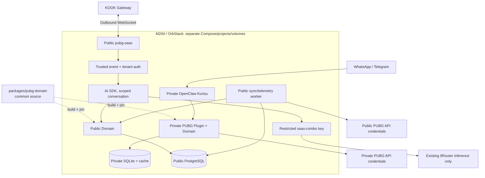
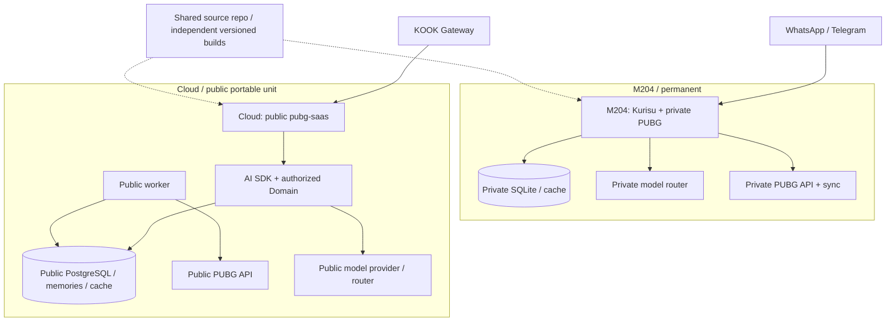

# PUBG KOOK SaaS V0.1 — Multi-tenant Domain & Independent Deployment Goal

> **Status (updated 2026-10-14):** M1 source/offline acceptance remains passed: private Kurisu regression 68/68; the expanded PostgreSQL-backed SaaS suite now passes 86/86 with no skips; typechecks, SaaS build, architecture/secrets checks passed. M2 source includes durable bounded worker scheduling, KOOK per-scope request limits, header-aware outbound backoff, a PostgreSQL daily outbound-message budget (default 200 per SaaS bot, noon Asia/Shanghai reset), the synthetic 200-team benchmark, encrypted public-schema backup/restore, and a pinned-base Compose/Image source unit. Higher KOOK budgets require confirmed developer-account eligibility and quota allocation across all bots. The restore tool skips the pre-existing `public` schema entry, restores objects as `pubg_migrator`, and reapplies runtime/backup grants. A six-hour UTC systemd backup job and exact-guard seven-day retention source is present but not installed. Fourteen backup/restore/retention safety tests pass; the one-shot backup job also created an encrypted artifact/manifest against the isolated PostgreSQL 18 fixture. A real decrypt/archive verification and 35-table disposable restore passed before migration `0011`; role-boundary probes passed and all disposable state was cleaned. P3 live test-server smoke now proves KOOK gateway authentication, one labeled outbox delivery, and sequence-1 session resume; human-user flows remain unverified because no test actor or second text channel was available. P4 now has a 100–200-case external-data benchmark runner with redacted reports, but no live provider benchmark has run. The P5 worker logs aggregate queue state/age and process RSS/heap without tenant identifiers; host alert rules and measured M204 headroom remain open. M2 remains operationally open: no image build, clean Linux host/cloud restore, scheduled-retention operation, egress policy test, or private/public stop-isolation drill. Live KOOK developer-account eligibility/remaining shared quota and live model accuracy/P95 remain unverified. Not deployed.
>
> **Date:** 2026-10-13 (Asia/Shanghai)
>
> **Source of truth:** `main` + live state verified at implementation time. This document is the explicit operator-selected Goal when invoked; it does not silently replace the current unrelated Goal in `docs/CURRENT_TASK.md`.
>
> **Audience:** Codex Goal executor. **This submission is documentation only** and does not authorize production deploy, migration, 9Router admin changes, creation of external cloud resources, or restarting the private OpenClaw.
>
> **Scope:** One public KOOK PUBG assistant targeting **200 squads**, with independently deployed private Kurisu PUBG capabilities, one source implementation of PUBG statistics, Vercel AI SDK, model calls through a dedicated `saas-combo`, local M204 launch and later public-only cloud relocation.

## 0. Executive decision: non-negotiable invariants

1. **One PUBG Domain implementation, many authorized teams:** a single `packages/pubg-domain` codebase, no forked `private-domain` vs `saas-domain` business algorithms. Multi-tenancy supports the private case naturally as **exactly one configured tenant**. Domain calculates facts; channel/application layer authenticates and authorizes. Explicit trusted TeamContext is required in public calls, with **no default-private-team fallback**.
2. **Two complete, independently runnable deployments:** Kurisu/OpenClaw + its own PUBG Plugin, SQLite, sync, API credentials, state and model route remain available on M204 forever. The SaaS uses a distinct Node.js app (not OpenClaw), Postgres, worker, user data, KOOK credentials and AI model policy. Neither deployment invokes the other's runtime PUBG service, DB, files, sessions or workers.
3. **Share source and domain contracts, NEVER required runtime dependencies:** each deployment embeds a separately built/pinned artifact of the same domain code, may upgrade at different times. Changing the shared domain once in Git enables both *after separate tests/releases*; it does not auto-upgrade or automatically restart Kurisu.
4. **M204 first; cloud-ready on day one:** all three public services are a portable Compose unit on the host-profile-selected OrbStack/CasaOS runtime. Later migrate **only** this unit and its public persisted state/credentials to a Linux cloud server; Kurisu and all private PUBG data stay on M204. Public SaaS must remain fully functional with M204 offline after cutover.
5. **200 squads, not 200 agents/processes:** one KOOK bot and one horizontally extensible application; isolate guild/tenant/team/session/user at the business/data boundaries. Allow multiple squads per KOOK guild and explicit channel-to-team mappings.
6. **Deterministic data and rights:** PUBG API facts, misdamage/teammate-kick/telemetry, KD/ranking, temporal interpretation, coverage, partial/unknown and evidenceRefs originate from domain, never from LLM invention. Model output never controls tenant identity, privileges, delivery destination, SQL or credential access.
7. **No production side effects from this Goal until separately approved:** no use of real KOOK token/API key, 9Router admin credentials, host firewall changes, OpenClaw production `--apply`, public cloud purchase or external exposure without an operator-authorized deployment gate. Codex may build and test using fixtures/isolated ephemeral environments.
8. **Public Git privacy:** repository is public. No real user IDs, guild IDs, PUBG account IDs, phone/JID, prompt transcripts, cloud IPs, tokens, private paths, host-profile contents or service admin URLs in Git, tests, screenshots or commits. Existing release/privacy gates remain authoritative.

### V0.1 deliverables

- KOOK WebSocket public bot: inbound/outbound messages, replies, card-button interactions, reconnect/resume, dedupe, retry, observable errors.
- Manager self-service: create squad, bind channel, add 1–4 players (support growth where rules permit), update roster, list status, unlink/disband with explicit confirmation and permissions.
- Player interaction: personal PUBG account claim/association, unbind, self stats, squad stats, misdamage/teammate kicks, ranking, comparisons, temporal queries, multi-turn follow-up, fun factual reviews; KOOK UI/DM for state-changing interactions.
- Independent public Postgres persistence, normalized data, scheduling/telemetry worker, quotas, short conversation context, opt-in team preferences, backups and public-only migration/restore proof.
- Regression-preserving adaptation of existing private PUBG Plugin to common Domain ports and trusted single-tenant context; private SQLite and existing functionality remain in place.
- A runnable local Compose public profile plus clean-Linux cloud restore/runbook and tests. No actual cloud provisioning as part of V0.1.

### Explicitly out of scope

Do not introduce a second public OpenClaw Gateway; do not migrate Kurisu to AI SDK or PostgreSQL; do not remove `plugins/pubg`, private SQLite, private worker, private team config or OpenClaw memory; do not introduce Mastra/LangGraph/Redis/Kafka/Kubernetes/microservices; do not develop a Web admin console, public WhatsApp/Telegram channels, payments, automatic entire-chat long-term memory, image generation, or a general purpose AI assistant. No owner notification delivery refactor. No copying private training/runtime/player data as public seed data.

## 1. Baseline to verify, not assume

Read `AGENTS.md`, `docs/CONTEXT.md`, `docs/CURRENT_TASK.md`, `docs/DEVELOPER_WORKFLOW.md`, `docs/VALIDATION_MATRIX.md`, `docs/COMMUNITY_PRIVACY_RELEASE_GATE.md` and the explicit Goal. Inspect `git status --short --branch`, `git log -5` and `pnpm workflow:plan`.

Current code anchors (recheck at execution):

- `packages/pubg-domain/src/service/pubg-domain-service.ts`: now consumes async `PubgRepositoryPort` and a validated `TeamContext`; the private plugin creates its single `private` scope from external configuration.
- `packages/pubg-domain/src/engine/query-engine.ts`: `DeterministicQueryEngine` requires a valid `teamContext` and returns `INVALID_QUERY` when it is missing or malformed; preserve stat math, evidence, time semantics and unknown/partial contracts.
- `packages/pubg-domain/src/storage/sqlite-repository-adapter.ts`: adapts the existing private SQLite implementation to the async port and pins the adapter to its tenant/team scope. The public adapter is `apps/pubg-saas/src/infrastructure/postgres/pubg-repository.ts`; complete edge-case parity remains pending.
- `packages/pubg-domain/src/storage/sqlite-repository.ts`: `listMatches` now selects player rows only for its selected matches; `SQLite listMatches loads players only for the selected match window` checks output and the query plan.
- `plugins/pubg/src/index.ts`: `serviceFor` loads one external `PUBG_TEAM_CONFIG_FILE`, stores `pubg.sqlite`, uses `identity.sqlite`; these remain the *private* adapter, not the public tenant registry.
- `plugins/pubg/src/adapters/openclaw.ts`: channels/trusted message context; DO NOT trust an arbitrary `sessionId` supplied in model tool args as the public auth/session boundary.
- `packages/identity/src/index.ts`: global `display_name_key UNIQUE` suits current owner/friends, not 800 public users with duplicate display names; do not break private identity binding to solve public use.
- `packages/presentation` and PUBG evidence/coverage contracts must be reused and preserved, not reinterpreted by platform UI.
- Existing private OpenClaw `2026.9.4` deployment scripts and `9Router` config are production-owned. User-visible `AGENTS.md` wording describing OpenClaw as the only Agent runtime refers to the **private agent estate**; the proposed AI SDK public SaaS is a separate application, **not a second private-agent planner or migration of Kurisu**.

If source or live deployment differs, record differences in a phase checkpoint. Use the actual host profile; do not embed owner-specific machine aliases/paths in templates.

## 2. Architecture and ownership boundaries

### 2.1 Same machine, independent processes (M204)



Deploy public services as exactly three primary containers, independently restartable: `pubg-saas` (KOOK adapter + app + AI), `pubg-worker` (scheduling/sync/telemetry), `pubg-postgres`; use one shared public application image with different commands for app/worker. `9Router` is existing infrastructure and can be shared *temporarily* only for authorized inference access; private and public model credentials and cost pools must not be inadvertently shared. Public app must not gain 9Router administrative privileges.

### 2.2 Future cloud: move public stack only



**Cloud readiness assertion:** run public application/worker/Postgres with a clean isolated configuration while M204/OpenClaw/private 9Router are unavailable. No `host.docker.internal`, household LAN endpoint, private SQLite, owner SSH key, private 9Router API key or live owner secret is permitted as a necessary dependency.

### 2.3 Layer ownership

| Layer | Owner | Contract |
| --- | --- | --- |
| KOOK transport | `apps/pubg-saas/src/channels/kook` | WebSocket authentication/sequence/heartbeat/reconnect/resume, interaction events, source metadata, message IDs; no PUBG math |
| Access / team / identity | `apps/pubg-saas/src/application` | validate trusted platform event, resolve guild/channel/user, create **AuthorizedScope**; admin and owner permissions; fail closed |
| Conversations / AI | public application | per-conversation compact context; AI SDK `generateText` + validated structured output; tool loops bounded; safe response generation |
| PUBG Domain | `packages/pubg-domain` | one shared algorithm, input and output schemas, stats and telemetry facts; scoped team context; no OpenClaw/KOOK/WhatsApp imports |
| Repository ports | domain contracts | asynchronous scoped query/write operations; no direct `SqlitePubgRepository` type in shared public service path |
| Persistence | SQLite/private; Postgres/public | both implement sufficient repository ports; public indexed data queries and transactions |
| Ingestion scheduling | independent instance-specific workers | rate limiter, dedup, leases, retry/backoff, parser version and coverage |
| Presentation | `packages/presentation` plus KOOK renderer | preserve structured facts/coverage; one KOOK card per query where possible |
| Ops/backup | `infra/pubg-saas` | independently deployable, restore-safe, bounded observability, no secrets |

Repository proposal (adapt to existing conventions): `apps/pubg-saas`, `infra/pubg-saas`, optional `packages/pubg-domain/src/ports` and `packages/pubg-domain/src/storage/postgres-*` or `apps/pubg-saas/src/infrastructure/postgres`. Prefer the smallest useful change: do not manufacture separate private/public Domain packages or framework abstractions without value. Public app must NEVER import `plugins/amadeus` or private OpenClaw bootstrap.

## 3. Domain migration contract: single source, independent data

1. Extract `PubgRepository` (or several small ports for match/telemetry/sync/result-set) based on actual needed methods; typed asynchronous access supports PG. Do not make domain aware of `SqlitePubgRepository`, SQL dialect or KOOK.
2. Preserve SQLite implementation and the private Plugin public tool schemas. Adapt synchronous SQLite through a minimal async wrapper if needed; **do not require a second DB** for private operation.
3. Replace construction-bound `team` in shared query logic with a validated per-request `TeamContext` or a short-lived scoped service created from a trusted context; do not cache unbounded service instances keyed by user-generated values. Define timezone and 06:00 business-day behavior consistently.
4. Ensure `tenantId` and `teamId` are always in public auth/persistence scopes, but do not make domain algorithm trust LLM-supplied IDs. For private plugin, bootstrap the sole trusted tenant and team from its existing protected config. A missing *public* binding MUST NOT use the private fixture/default team.
5. Preserve `ToolEnvelope`, `coverage`, `asOf`, `metricVersion`, `queryResolved`, `evidenceRefs`, partial/no-matches/unknown, stats formulas and parser/feature versioning. No invented numbers or silent stale->fresh conversion.
6. Fix `listMatches` N+all-players anti-pattern: join/limit `match_players` to selected match IDs and add indexes. Public repo filters indexed time/player/match constraints in SQL, not by scanning all tenants' records into Node memory. On a given request only authorized selected records may reach domain math.
7. Reuse normalized public match/player facts by official `shard + matchId` within a **single public deployment**. Telemetry review features are derived from a team's roster and aliases, so key them by tenant/team, a digest of the active team configuration, shard/match ID and parser/feature version. Never share those derived facts across teams. A future shared raw-telemetry cache needs a separate game-only contract. Team roster/preferences/resultsets remain tenant scoped; shared match facts never authorize access to another team's private membership, aliases, history or conversations.
8. Allow the private SQLite and public PostgreSQL to evolve at different release times; shared domain types are stable/tested, with independent image pins and release notes.

Domain golden tests: run one fixture set through private SQLite and public Postgres adapter, compare deterministic output and evidence for stats, KD, team damage, kick/melee, revives, group rank, relative periods, 06:00 boundary, 0 matches, partial telemetry and unknown coverage. Preserve legacy private API surface and existing test suite.

## 4. Public tenant, identity and conversation model

### 4.1 Primary keys and permissions

- `tenant` = KOOK guild, or a stable internal tenant UUID with unique (platform, guildId) identity. `team` = squad within a tenant; multiple squads per guild. `channel_binding` maps verified channel -> team, with explicit admin changes and conflict handling.
- KOOK `userId` is platform identity, `pubgAccountId` is official game identity, and `team_member` is **a relationship**; one account may participate in multiple squads. Do not equate display nickname with stable identity or enforce global nickname uniqueness.
- Suggested tables: `tenants`, `guild_memberships` / actor grants, `teams`, `channel_bindings`, `users` / `channel_identities`, `pubg_accounts`, `team_members`, `account_claims` (claimed vs verified), `team_aliases`, `team_preferences`, `conversation_states`, `result_sets`, `matches`, `match_players`, `telemetry_features`, `sync_state`, `sync_jobs`, `message_inbox`, `message_outbox`, `usage_records`. Merge tables only where clear constraints preserve semantics.
- Unique constraints scoped correctly; e.g. channel identity uniqueness within (platform,botAccount,userID), channel bindings within tenant and channel. No global display-name uniqueness for public users; enforce transactions for create/rebind/claim/unclaim.
- All tenant-owned reads/writes need `tenant_id`; team-owned data also needs `team_id`; conversation/result-set lookup additionally checks user/channel/session and expiry. Indices, migrations, transaction boundaries and deletion rules must be explicit. Consider PG row-level security only as an additional defense, **not** a substitute for business authorization.
- Public trusted context MUST be derived by server code from verified KOOK gateway event and DB ownership: `{ platform, botAccount, guildId, channelId, senderId, tenantId, teamId, requestId }`. API callers cannot pass arbitrary tenant/team fields to evade authority. Validate KOOK permissions on every state-changing management action, not from stale chat text.

### 4.2 Onboarding UX

1. Bot invited: public welcome card in relevant channel; no automatic privileged setup on ordinary message.
2. Verified guild admin presses **Create squad** or **Bind existing squad**; app resolves the acting user and channel, validates current permissions, creates team + binding transactionally.
3. Admin enters 1–4 PUBG names/platform; official API resolves durable PUBG Account IDs; show confirmation, clear ambiguity/missing name; do not require each of four users to sign up before stats are usable.
4. Player clicks **Claim my PUBG account**; private KOOK DM or safe interaction, selection/search and explicit confirmation. Mark claim **self-declared / unverified ownership** unless a validated proof flow exists; prevent cross-user hijack and support conflict resolution/admin roster actions.
5. Show **Team status**, **My stats**, **Today/yesterday**, **Team damage**, **Leaderboard**, **Review**, **Unbind** as cards/commands. Track interaction tokens with actor binding, TTL, replay protection, one-use semantics and auditable mutations. Verify KOOK card `return-val` callback mechanics against real test bot, and fail safely if unavailable.
6. DM requests cannot guess a guild/team: require an explicit selected authorized team when identity has several; never fall back to last other user's conversation.

### 4.3 Conversations / memory

- Free-text replies use AI SDK with the public dedicated `saas-combo` and **domain constrained** intents. Queries like “昨晚谁踢队友最多？” -> “那他对谁伤害最高？” -> “和上周比？” must resolve the correct player and period from one authorized conversational thread.
- Prefer message-reply correlation (`inReplyToMessageId`) plus bounded requester/channel/team short context. A single shared per-guild context is unsafe. If context ambiguous, ask one clarification rather than query a guessed teammate.
- Store compact query/subject/time/evidenceRef plus minimal recent messages with TTL (initial design e.g. <=24h inactive; configurable). Persist explicit user/team preferences and aliases only after confirmation. Do not auto-ingest every channel conversation into long-term memory, and do not allow cross-tenant retrieval.
- Deterministic cards/commands and account management **never call an LLM**; free-text understanding uses `generateText` with schema (Zod), validation and a bounded token budget. Optional bounded tool loop only if a single structured plan cannot meet a tested use case; never expose arbitrary shell/filesystem/network/SQL/other sessions.
- Model-generated review gets **only sanitized, scoped fact envelopes**, capped length and style; validation ensures numeric claims/coverage come from evidence, and suppress/qualify unsupported numbers.

## 5. Public ingress, resilience and upstream limits

### KOOK

Use **outbound WebSocket**, not public webhook or a VPS proxy. Implement documented auth/heartbeat/sequence, reconnect/resume, backoff + jitter, duplicate/in-order event handling, and a bounded inbound queue. Store the source event key and original trusted destination. Persist inbox dedupe and reply outbox with delivery status, retry deadlines and idempotency keys; allow for at-least-once events and that the provider may not guarantee exactly-once sends. Never let model output select arbitrary KOOK destination. Do not send a speculative extra “thinking…” message if it wastes quotas.

Keep message/endpoint rate limits and current KOOK developer verification/guild capacity as **verified configuration/preflight**, not hardcoded promises. First verify account eligibility for 200 guilds. Control per-user/per-channel/per-tenant and global request limits, plus send quota use; avoid assuming all outbound notifications are free.

### PUBG API & ingestion

- Independent PUBLIC PUBG API credential/config, legal access and global limiter. Do not share the private client's key/queue as a runtime dependency; a distinct key may still share policy/account-side platform quotas, so verify rather than promise independent rate buckets.
- Default development rate limit reported by PUBG is 10 requests/minute; check live headers/docs and apply to relevant request types, distinguish match/telemetry exceptions. Batch player lookups where supported, dedupe player and match requests. Pursue official rate-limit increase only with measured usage.
- Scheduler prioritizes interactive cache misses with bounded timeouts; discovery of player recent matches must account for API retention window; active players refreshed based on use and quotas; no 800 individual uncoordinated cron jobs.
- Queue table with `FOR UPDATE SKIP LOCKED` or equivalent leases, bounded retries/backoff, dedupe keys, starvation control and idempotent jobs. Start one worker and low telemetry concurrency. Ingest normalized match facts once and reuse facts within public DB; parsing versioned. Expose fresh/stale/partial/unavailable in user-facing response.
- Scheduled telemetry/report jobs belong to PUBLIC worker; owner/private Cron remains untouched.

### Models / 9Router

V0.1 uses open-source **Vercel AI SDK library** on local Node.js; **no Vercel deployment, AI Gateway subscription or Vercel model credits required**. Configure an OpenAI-compatible endpoint with `MODEL_BASE_URL`, `MODEL_ID` (e.g. `saas-combo`) and public inference-only key. Validate actual structured output/tool compatibility of primary/fallback models; on bad output bounded retry and safe plain-template response.

Use explicit public model budget, token and request quotas and per-tenant usage. A Combo does not itself prove hard spend caps or distinct underlying providers. Do not route public service through personal subscription accounts unless their API terms authorize third-party use. If common 9Router API path also exposes admin endpoints, use a restricted network/proxy path or separate inference endpoint with enforceable scope; a distinct API key alone is not full network isolation. On future cloud migration, change only provider config to a **cloud-independent public endpoint** (public router or official model API); no callback home.

## 6. Deployment, security, observability, data portability

### M204 local Compose

Implement `infra/pubg-saas/` declarative Compose templates, immutable pinned/buildable ARM64 public images, unique Compose project, separate public Docker network and volumes; runtime paths/config derived from controlled host profile, never hardcode a personal IP or private mount. `pubg-postgres` only on a private network; public admin/health endpoints loopback only if required. App uses least-privilege runtime user, read-only FS where compatible, `no-new-privileges`, cap drop, resource/pid limits and log rotation; **never** mount `docker.sock`, host SSH, NAS, Kurisu/OpenClaw state or owner secrets. Explicitly test egress restrictions to private host/LAN services and metadata endpoints; default Docker bridge outbound is not sufficient isolation. Public API/worker/Postgres should not join broad private `amadeus_network` without a reviewed network policy. Prefer an inference-only bridging proxy if needed.

Initial resource envelope **measurement target, not guaranteed usage:** app <=1 GiB memory, worker <=2 GiB, Postgres <=1 GiB, Telemetry concurrency 1, bounded connection pool, no admission above measured safe host headroom; verify especially against existing high-memory native ML workloads and OrbStack swap pressure. Degrade worker first to protect both chat ingress and Kurisu. Storage growth alarms for PG, logs, cached payloads and backups.

### Observability / privacy

Track `requestId`, redacted tenant/team/request correlation, message in/out rates, dedupe/retry, worker queue lag, Pubg API RPM/429, cache hit/miss/coverage, latency P50/P95, per-model token usage and budget, PostgreSQL connections/slow queries, container RSS/swap/health. Logs and metrics must not contain private messages, raw user IDs/names, access tokens, full model prompts or URL secrets; controlled redaction, bounded retention. User-facing help/privacy statement and self-serve unlink, delete preference, disband policies. Keep admin events auditable without storing unnecessary personal data.

### Backups and future cloud migration

- Public Postgres gets automated consistent backups with external encrypted copy, tested logical restoration, secure independent secret bundle, schema migration manifest and checksum/count verification. Initial **design targets**: backup <=6h between checkpoints (RPO up to 6h barring a more advanced PITR policy), 7+ days of restore points, tested recovery before public launch. Backup need not include regenerable raw public match data if coverage and retention contract is explicit.
- No private SQLite/workspace/state ever included in public backup. No public PG/users/memories imported into private Kurisu on cloud cutover.
- Clean Linux/ARM64-amd64 images and Compose configurations must be validated in an isolated fresh environment without M204 runtime endpoints. If an architecture-specific native package fails, fix build and document; do not silently rely on macOS.
- Cutover runbook: verify backups, cloud test via **test bot** first, stop old public ingress/worker, final consistent DB sync, run migrations, start new public app with original KOOK credentials, verify healthy inbound/outbound and tenant isolation, keep old public instance stopped, retain rollback snapshot. Do not run old and new public workers on separate writable databases concurrently.
- Both explicit independence drills are mandatory: stop **all PUBLIC** M204 containers -> Kurisu PUBG still works from private SQLite/API; isolate M204 entirely -> restored cloud PUBLIC service still functions with independent API/model services.

## 7. Codex execution plan (complete phases, stop gates, commits)

Implementation may proceed without repeated design questions; operator-facing live/apply actions remain separately authorized. Do **not** mark a phase passed on mock-only evidence.

| Phase | Deliverable | Exit gate / acceptance |
| --- | --- | --- |
| **P0 — Audit and contract freeze** | Fresh baseline inventory, public/private dependency graph, edge-case fixtures and golden tests; explicit phase checkpoints. Identify real side effects and known ongoing goals. | Existing `pnpm typecheck:pubg` and `pnpm test:pubg` green; clean public/private boundary map; no production state changes. |
| **P1 — Shared multi-tenant-capable Domain** | Async repository port(s); scoped TeamContext; current SQLite adapter preserved; bounded joins; independent private plugin unchanged externally. | Both private API/tool compatibility tests + golden fixture stat parity; no owner credentials exposed; private synthetic single tenant works alone; non-authorized default team rejected in public. |
| **P2 — Public persistence/application auth** | Postgres migrations/schema/indexes, identity/tenant/team/channel ownership, transactionally safe management and account claims, scoped result sets and conversation state. | Multi-tenant CRUD+integration tests on ephemeral Postgres; 2 guilds/2 users isolation, cross-team result-set and privilege-denial tests, repeated nicknames supported. |
| **P3 — Public KOOK onboarding/transport** | KOOK WS adapter, cards, DM/interaction confirmations, event inbox/outbox, idempotency and outbound retry; isolated test bot. | Offline protocol fixtures plus real test KOOK guild if credentials/operator approval; reconnection/resume, duplicate messages, cross-channel delivery, callback replay/rebind unauthorized denial. |
| **P4 — AI SDK natural-language UX** | `saas-combo` provider, validated QueryPlan, limited context, safe review generation, deterministic paths without AI, fallback and spend accounting. | Deidentified ~100–200 prompt benchmark incl Chinese alias/time/follow-up/teammate misdamage, injection and hallucinations; results compared against existing Kurisu PUBG behavior; report accuracy and token/P95. |
| **P5 — Ingestion, observability, resources** | Public PG scheduler/worker, global rate limiting, cache and parser versioning, metrics, alarms, resource caps, Compose CI/build and failures. | Multi-tenant simulated load 200 teams (~800 users), baseline ~30 queries/team/day if chosen; measured API rate compliance, KOOK message quota math, latency/resource report, partial coverage truthful; private workloads unaffected. |
| **P6 — Backup/restore and migration rehearsal** | Secure backup, restore/migration runbook, immutable independent public image, fresh Linux recovery simulation, independence drills, privacy/deletion docs. | Stop public -> private still functions; restore public elsewhere -> public works with old host isolated; record RPO/RTO, secret checks and rollback; still no real cloud purchase required. |
| **P7 — Controlled release review** | Summarize all phase evidence and blockers, update scoped architecture/docs without erasing private-only policies, and request operator go/no-go. | All gates pass and operator explicitly authorizes KOOK live onboarding/production `--apply` and any changes to 9Router or private deployed runtime. NO implicit deployment on successful tests. |

Development order may re-sequence P3/P4 with mock ingress to find AI issues early, but **P1 and P2 safety boundaries cannot be deferred behind a live public rollout**. Use small auditable commits per phase; each phase should identify changed files, commands, results, unresolved assumptions, next checkpoint and rollback strategy. No blanket performance claim without load result. Existing `docs/CURRENT_TASK.md` points to other concurrent work: Codex must avoid applying it unintentionally and should update task pointer only when operator activates this Goal in its working branch.

### Exact high-value security/functional tests

1. A guild user requests B guild history/alias/result-set/membership via prompt injection -> denied without returning private existence/details.
2. Multiple authorized squads within one guild in different channels -> routed correctly; ambiguous private DM asks selected team.
3. Same player account in two teams, repeated public display nicknames, duplicate button callbacks and unbind claims -> consistent DB state.
4. Two same-channel users interleave “他/昨天/那局”; quote-reply to bot previous answer and normal unquoted messages -> no cross-user conversation contamination.
5. Model returns spoofed `tenantId`, `guildId`, recipient or SQL -> ignored/rejected before any data or send.
6. Malformed/oversized KOOK event, disconnected WS, replayed `sn`, duplicate event/outbox -> bounded recoverable behavior.
7. Telegram/WhatsApp private plugin stats and existing 06:00 dates, ranking/misdamage, ASR/TTS/image and owner notifications -> unchanged by public domain rebuild and standalone public deployment.
8. Entire public stack stopped; private still has its SQLite, API key, worker and domain; entire private network unavailable; public restored stack still works independently.
9. Unknown/unavailable/partial API/telemetry + budget exhausted + model 429/5xx -> honest degraded response, no fabricated success.
10. Large `match_players` dataset + 200-team concurrency -> indexed scoped query, bounded RSS and no full table scan on hot path.

### Verification levels and evidence

- At each source phase: `pnpm workflow:plan`, targeted package typecheck/build/tests, `pnpm typecheck:pubg`, `pnpm test:pubg`, architecture/secret checks, `git diff --check`. New `pubg-saas` receives `build/typecheck/test/smoke` scripts and CI coverage.
- Before candidate release: `pnpm check:secrets`, public privacy gates, deterministic fixtures, container builds on fresh ARM64 Linux and clean Linux amd64 as feasible, restore tests, license/ToS review, documented measurable load testing, and regression of Kurisu via existing source tests.
- Report live validations separately from mock/fixture; do not claim KOOK production verified without credentials and actual end-to-end evidence.
- Never use `scripts/deploy-openclaw.sh --apply`, production 9Router apply, destructive `docker compose down -v`, private DB schema migration or private runtime restart as an incidental development action. Production rollout is a separate explicitly confirmed phase with backup/rollback checkpoints.
- On actual publication, follow PUBG developer TOS (including commercial-use/data terms), current KOOK developer approval/quota rules and model-provider third-party service rights. Record blockers; do not evade limits via multiple credentials.

## 8. Repo delivery and documentation updates expected from Codex

The executing Codex should keep this Goal the canonical scope and create only the files needed by phases, likely:

```text
apps/pubg-saas/
  src/channels/kook/
  src/application/{auth,teams,conversation,ai,queries}/
  src/infrastructure/{postgres,queue,pubg}/
  src/gateway.ts
  src/worker.ts
  tests/
  Dockerfile
infra/pubg-saas/
  compose.yaml
  .env.example                 # placeholders only, never production values
  README.md                    # local deploy, isolated test bot, backups, migration
packages/pubg-domain/
  src/...                      # ports/context/core preservation
plugins/pubg/
  src/...                      # private adapter with no changed external behavior
docs/
  PUBG_KOOK_SAAS_V0_1_GOAL.md   # this explicit Goal
  ARCHITECTURE.md              # append public architecture, keep private valid
  PROJECT_MAP.md               # new route map
  VALIDATION_MATRIX.md         # public service test/build tier
```

No phantom packages or long-lived duplicated private/public business logic. Existing code is the source of facts: adapt target paths after inspect. Do not overwrite existing owner deploy scripts, runtime paths or architecture decisions unrelated to public app. A new startup target is not permission to change legacy Kurisu agent persona, channels, image/voice pipeline or private release semantics.

## 9. Definition of done and reporting format

**Done** means source + tests + docs + repeatable deployment artifacts, with each relevant phase gate passed; live public operation needs separately approved real acceptance. Report:

- `commit SHA` / affected source paths and published test commands;
- actual privacy/tenant-isolation evidence, domain parity evidence and 200-squad load report;
- API/KOOK quota assumptions checked against live policy;
- measured M204 resource headroom and memory peaks, not estimates labeled as benchmark;
- backup/restore drill results with public/private independence proof;
- explicit known blockers, accepted risks and go/no-go decision for production.

**Never say “200 squads supported” solely because schema permits 200 rows**; demonstrate constrained-load benchmark and official platform/API quota feasibility.

## 10. Copy-ready Codex execution directive

```text
/goal docs/PUBG_KOOK_SAAS_V0_1_GOAL.md

This is my explicitly selected active Goal. Implement it phase by phase in the existing monorepo (do not merely restate a plan). Read AGENTS.md, CONTEXT.md, CURRENT_TASK.md, the Goal and live Git state. Build a single reusable multi-tenant-capable PUBG Domain with private single-tenant OpenClaw+SQLite and public multi-tenant KOOK+Vercel AI SDK+PostgreSQL using independent images, storage, credentials, workers, release lifecycles. Private Kurisu must remain complete and offline-independent of public SaaS, and vice versa after cloud migration. Start with P0 baseline and golden tests, then the contract/refactor and public stack. Produce small checked commits with phase gates, threat tests, backup/restore rehearsal and measured 200-squad simulated load. Preserve all existing Kurisu/WhatsApp/voice/image/owner notification functionality. Do not perform production apply, deploy, expose routes, provision a cloud server, change 9Router production config or touch real secrets without my separate explicit authorization. At any external-credential-only blocker, complete mock/integration portions and report the concrete operator-only action; do not fake a live pass.
```

### References for implementation (verify compatibility at code time)

- Existing repo: `AGENTS.md`, `docs/DEVELOPER_WORKFLOW.md`, `docs/COMMUNITY_PRIVACY_RELEASE_GATE.md`, `packages/pubg-domain/README.md`, `plugins/pubg/README.md`.
- Vercel AI SDK: https://ai-sdk.dev/docs/reference/ai-sdk-core/generate-text and https://ai-sdk.dev/docs/reference/ai-sdk-core/output .
- PUBG Developer: https://developer.pubg.com/faq?locale=en .
- KOOK developer docs: https://developer.kookapp.cn/ .
